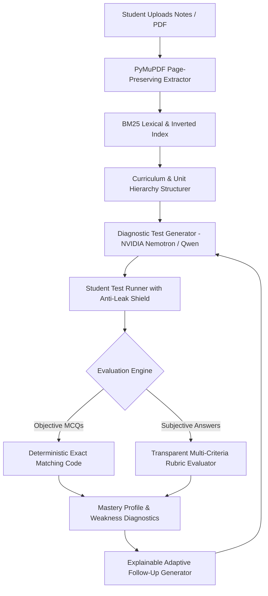

<div align="center">

# 🎯 ExamLoop

### Personalized, Source-Grounded & Adaptive Exam Preparation Engine

[](https://vercel.com/new/clone?repository-url=https%3A%2F%2Fgithub.com%2Fsahil24raj%2FExamLoop&root-directory=frontend&env=NEXT_PUBLIC_API_URL&envDescription=Backend%20API%20URL%20(e.g.%20deployed%20FastAPI%20URL%20or%20http%3A%2F%2F127.0.0.1%3A8000)&project-name=examloop)
[](https://nextjs.org/)
[](https://fastapi.tiangolo.com/)
[](https://www.python.org/)
[](https://www.typescriptlang.org/)
[](https://tailwindcss.com/)
[](LICENSE)

[](https://learn-ai-basics.devpost.com/)

<br />

**Turn your course material & lecture notes into an evidence-grounded revision loop:**  
*Upload Material → Extract Topics → Diagnostic Test → Transparent Rubric Grading → Weakness Analysis → Targeted Retesting.*

> 🏆 Built for the **[Devpost Build With AI: Basics](https://learn-ai-basics.devpost.com/)** Hackathon following the official 6-step agent skills curriculum (`1-start` → `6-ship`).  
> 📑 **Curriculum Artifacts**: [Scope](file:///devpost/scope.md) &bull; [PRD](file:///devpost/prd.md) &bull; [Technical Spec](file:///devpost/spec.md) &bull; [Build Checklist](file:///devpost/checklist.md) &bull; [Interactive App Map](file:///devpost/app-map.html) &bull; [Submission Guide](file:///devpost/submission.md)

</div>

---

## 🌟 The Problem & The Solution

| The Traditional AI Study Problem ❌ | ExamLoop Solution 🎯 |
|:---|:---|
| Generic flashcards with hallucinations | **100% Source-Grounded Questions:** Every question & criterion is explicitly cited with document name and exact page numbers. |
| Subjective answers evaluated with arbitrary grades | **Transparent Multi-Criteria Rubrics:** Point breakdown per rubric item, extracted student excerpts, and explicit identification of missing concepts. |
| Inconsistent AI grading for multiple-choice | **Deterministic Objective Scoring:** MCQs are evaluated mathematically in code with zero prompt variance. |
| Unexplained recommendations | **Explainable Adaptive Follow-up:** "Why this test?" rationale transparently explains which weak concepts triggered which revision questions. |
| Costly API calls for basic testing | **Resilient Hierarchical Fallbacks:** NVIDIA Nemotron free tier with immediate reasoning fallback + offline zero-token DBMS demo seeder. |

---

## 🚀 1-Click Deployment to Vercel

You can auto-deploy the frontend instantly using Vercel's pre-configured monorepo template:

[](https://vercel.com/new/clone?repository-url=https%3A%2F%2Fgithub.com%2Fsahil24raj%2FExamLoop&root-directory=frontend&env=NEXT_PUBLIC_API_URL&envDescription=Backend%20API%20URL%20(e.g.%20deployed%20FastAPI%20URL%20or%20http%3A%2F%2F127.0.0.1%3A8000)&project-name=examloop)

### Manual Vercel Setup (Step-by-Step)
1. Fork or push this repository to your GitHub account: `https://github.com/sahil24raj/ExamLoop`
2. Go to [Vercel Dashboard](https://vercel.com/new) and click **"Add New Project"**.
3. Import your **ExamLoop** repository.
4. In the Project Configuration:
   - **Framework Preset**: Next.js (automatically detected)
   - **Root Directory**: Click *Edit* and select `frontend` (or leave default if using the included `vercel.json`)
5. In **Environment Variables**:
   - `NEXT_PUBLIC_API_URL`: Your hosted FastAPI backend URL (e.g. `https://your-backend.railway.app` or `https://your-backend.onrender.com`).
6. Click **Deploy**! 🚀

---

## 🏗️ System Architecture



### Repository Structure

```
ExamLoop/
├── .github/                       # GitHub Actions workflows & CI/CD
├── backend/                       # High-performance FastAPI backend
│   ├── app/
│   │   ├── config.py              # App settings & LLM model hierarchy
│   │   ├── database.py            # SQLite & PostgreSQL database session factory
│   │   ├── models.py              # SQLModel/SQLAlchemy relational models
│   │   ├── schemas.py             # Pydantic v2 validation contracts
│   │   ├── fixtures/
│   │   │   └── dbms_demo.py       # Zero-token verified DBMS demo suite
│   │   ├── routers/               # REST API endpoints (subjects, documents, tests, grading)
│   │   └── services/              # Document, AI, BM25 retrieval, scoring, & adaptive services
│   ├── tests/                     # Comprehensive 17-suite automated test suite
│   └── requirements.txt           # Python dependencies
├── frontend/                      # Modern Next.js 16 Web Application
│   ├── src/
│   │   ├── app/                   # App Router pages (Dashboard, Subjects, Tests, Results, Settings)
│   │   ├── components/            # UI components (Navbar, EvidenceModal, Timer)
│   │   └── lib/                   # Typed API client & data utilities
│   ├── public/                    # Static branding & assets
│   ├── vercel.json                # Frontend Vercel configuration
│   └── package.json               # Node.js dependencies & scripts
├── docs/                          # Architecture PRDs & Task roadmaps
├── .env.example                   # Backend environment template
├── vercel.json                    # Root Vercel monorepo auto-build config
└── README.md                      # Comprehensive Hackathon & Developer Guide
```

---

## 🎬 3-Minute Hackathon Demo Script

For Hackathon judges evaluating the user experience, follow this step-by-step walkthrough:

1. **One-Click Instant Seed (`/dashboard`):**
   - Click the green banner: **"Load Verified DBMS Demo"**.
   - Instantly seeds a university-grade *Database Management Systems* curriculum with 4 foundational units: *Relational Normalization*, *SQL Joins*, *ACID Transactions*, and *B+ Tree Indexing*.
2. **Curriculum & Source Grounding (`/subjects/[id]`):**
   - Review extracted topics and their source citations.
   - Click **"Generate Diagnostic Test"** to witness NVIDIA Nemotron creating source-grounded questions and rubric criteria.
3. **Secure Student Test Taking (`/tests/[id]`):**
   - Experience the distraction-free exam interface with real-time countdown timer.
   - Notice the security guarantee: correct answers, solutions, and rubric weights are strictly withheld from client-side network payloads until submission.
4. **Transparent Rubric Breakdown (`/results/[id]`):**
   - View deterministic MCQ grading.
   - Expand subjective answers to view criterion-by-criterion marks, exact quotes of student evidence, and identified misconceptions.
   - Click **"View Source Evidence"** to open the side-drawer citation matching the lecture notes.
5. **Closing the Loop (`Adaptive Follow-up`):**
   - Read the **"Why This Follow-up Test?"** section explaining why specific questions were chosen to reinforce detected gaps.
   - Click **"Generate Targeted Follow-up"** to experience true adaptive learning.

---

## ⚡ Local Development Setup

### 1. Prerequisites
- **Node.js 18+** & npm
- **Python 3.10+** (Fully compatible with Python 3.14)
- Git

### 2. Backend Setup
```bash
# Navigate to backend
cd backend

# Install dependencies
pip install -r requirements.txt

# Run automated test suite (Zero-token verification)
python -m pytest tests/ -v

# Start FastAPI server
python -m uvicorn app.main:app --host 127.0.0.1 --port 8000 --reload
```
- API is running at: `http://127.0.0.1:8000`
- Interactive OpenAPI Docs: `http://127.0.0.1:8000/docs`

### 3. Frontend Setup
```bash
# In a new terminal, navigate to frontend
cd frontend

# Install dependencies
npm install

# Start Next.js development server
npm run dev
```
- Web interface is running at: `http://localhost:3000`

---

## 🔐 Environment Variables

### Backend (`.env`)
| Variable | Description | Default |
|:---|:---|:---|
| `APP_ENV` | Application environment | `development` |
| `DATABASE_URL` | Database connection string | `sqlite:///./backend/examloop.db` |
| `DEMO_MODE` | If `true`, enables zero-token deterministic fixtures | `true` |
| `OPENROUTER_API_KEY` | OpenRouter / Nebius AI API token | `your_api_key_here` |
| `OPENROUTER_BASE_URL` | AI API base URL endpoint | `https://openrouter.ai/api/v1` |
| `OPENROUTER_FAST_MODEL` | Primary high-throughput model | `google/gemini-2.5-flash` |
| `STORAGE_DIR` | Directory for uploaded student documents | `./backend/storage` |

### Frontend (`frontend/.env.local`)
| Variable | Description | Default |
|:---|:---|:---|
| `NEXT_PUBLIC_API_URL` | Endpoint of the FastAPI backend | `http://127.0.0.1:8000` |

---

## 🧪 Automated Testing & Reliability

ExamLoop includes an automated test suite verifying edge cases, prompt injection safety, deterministic scoring, and anti-leakage guards:

```bash
python -m pytest backend/tests/ -v
```

```
backend/tests/test_examloop.py::test_page_chunking_preserves_page_numbers PASSED
backend/tests/test_examloop.py::test_empty_or_scanned_pdf_fails_gracefully PASSED
backend/tests/test_examloop.py::test_invalid_ai_json_repair_and_clean PASSED
backend/tests/test_examloop.py::test_mcq_scoring_deterministic PASSED
backend/tests/test_examloop.py::test_rubric_sum_validation PASSED
backend/tests/test_examloop.py::test_subjective_blank_answer_scores_zero_deterministically PASSED
backend/tests/test_examloop.py::test_subject_scoped_retrieval_excludes_deleted_and_other_subjects PASSED
backend/tests/test_examloop.py::test_prompt_injection_safety_in_student_answer PASSED
backend/tests/test_examloop.py::test_adaptive_selection_responds_to_weak_topics PASSED
backend/tests/test_examloop.py::test_duplicate_submission_is_idempotent PASSED
backend/tests/test_examloop.py::test_student_test_view_does_not_leak_answers PASSED
backend/tests/test_examloop.py::test_end_to_end_smoke_flow PASSED
backend/tests/test_syllabus_upgrade.py::test_syllabus_hierarchy_extraction_explicit_vs_inferred PASSED
backend/tests/test_syllabus_upgrade.py::test_custom_test_generation_exact_counts_and_subtypes PASSED
backend/tests/test_syllabus_upgrade.py::test_student_question_view_security PASSED
backend/tests/test_syllabus_upgrade.py::test_normalized_score_calculation_out_of_10 PASSED
backend/tests/test_syllabus_upgrade.py::test_idempotent_attempt_submission PASSED

============================= 17 passed in 2.97s ==============================
```

---

## 🤝 Contributing & License

ExamLoop is open-source software built for educational empowerment. Distributed under the [MIT License](LICENSE).
Contributions, bug reports, and feedback are welcome!