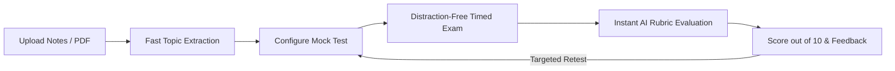

<div align="center">

# 🎓 ExamLoop — A Personal AI Exam Coach

### Turn Course Material & Lecture Notes into an Evidence-Grounded Revision Loop

[](https://learn-ai-basics.devpost.com/)
[](https://nextjs.org/)
[](https://fastapi.tiangolo.com/)
[](https://supabase.com/)
[](https://tailwindcss.com/)
[](LICENSE)

<br />

> 🏆 **Built for the [Devpost Build With AI: Basics Hackathon](https://learn-ai-basics.devpost.com/)**  
> Developed using the official **Devpost Learn 6-Step Agent Skills Framework** (`1-start` → `6-ship`) to practice plan-first, spec-driven AI development.

<br />

| 📄 [Scope](devpost/scope.md) | 📋 [PRD](devpost/prd.md) | ⚙️ [Tech Spec](devpost/spec.md) | ✅ [Build Checklist](devpost/checklist.md) | 🗺️ [Interactive App Map](devpost/app-map.html) | 🚀 [Devpost Submission](devpost/submission.md) |
|:---:|:---:|:---:|:---:|:---:|:---:|

</div>

---

## 💡 What is ExamLoop?

Students often spend 80% of their exam preparation passively reading notes or highlighting textbooks, only to freeze during the actual exam. **ExamLoop solves passive study habits by replacing them with the Feynman technique and active recall.**

ExamLoop turns any uploaded syllabus, lecture slides, or PDF notes into personalized, interactive exam simulations:
1. **Material Ingestion**: Upload course PDFs or DOCX files; ExamLoop automatically extracts key syllabus topics.
2. **Flexible Test Builder**: Choose between **Objective (MCQs)** or **Subjective (Free response)** tests, set difficulty levels (Easy, Medium, Hard), and select topic coverage.
3. **Timed Test Runner**: Take tests in a distraction-free dark interface with live countdown timers, question navigation, and autosave.
4. **Diagnostic AI Grading**: Submissions are graded instantly with a score out of 10, itemized explanations for every answer, and actionable coaching tips.
5. **The Exam Loop**: Performance history is saved, allowing students to re-test on specific gaps until mastery is achieved.

---

## 🏆 Devpost Learn AI Basics — Curriculum & Proof of Concept

This project strictly adheres to the **Devpost Learn AI Basics** curriculum, packaging the planning, architecture, verified slices, and code tour:

```
devpost/
├── scope.md          # Step 2: The unique kernel, persona & POC boundary (approved)
├── prd.md            # Step 3: Complete product requirements & core journey (approved)
├── spec.md           # Step 4: Technical architecture & component contracts (approved)
├── checklist.md      # Step 5: 5 verified build slices & code tour record (approved)
├── app-map.html      # Step 5: Standalone interactive SVG app map & tour
└── submission.md     # Step 6: Complete Devpost submission form write-up & guide
```

### The 6-Step Agent Skills Journey:
* **`1-start`**: Learner profile established, defining experience with plan-first workflows.
* **`2-scope`**: Sharpened the unique kernel: a closed-loop exam engine with diagnostic scoring out of 10.
* **`3-prd`**: Product definition detailing the core journey, dark emerald UI tokens, and states.
* **`4-spec`**: Technical blueprint specifying Next.js 14, FastAPI, Supabase Auth (ES256/RS256 JWKS), and Groq/OpenAI JSON schemas.
* **`5-build`**: Delivered 5 verified incremental build slices, hands-on review, and code tour.
* **`6-ship`**: Packaged for public GitHub distribution and Devpost evaluation.

---

## 🔄 The ExamLoop Core Engine



---

## ✨ Key Features

| Feature | Description |
|:---|:---|
| **📄 Multi-Format Ingestion** | Upload lecture PDFs, Word documents (.docx), or paste raw text; instant parsing with zero UI lag. |
| **🎯 Objective & Subjective Tests** | Generate 4-option MCQs with clear reasoning, or conceptual free-response questions with rubric keys. |
| **⏱️ Timed Test Runner** | Full-screen distraction-free interface with question stepper, countdown timer, and local autosave. |
| **📊 Transparent AI Grading** | Every attempt receives a normalized score out of 10, strengths breakdown, and itemized feedback for every question. |
| **🛡️ Anti-Cheat Security** | Correct answers, solutions, and rubric weights are strictly withheld from client-side network payloads until submission. |
| **💾 Persistent Dashboard** | All subjects, materials, and test attempts are securely stored in PostgreSQL under your authenticated account. |

---

## 🏗️ Technical Architecture & Stack

- **Frontend**: Next.js 14 (App Router), React 18, TypeScript, Tailwind CSS, Lucide React icons.
- **Backend**: FastAPI (Python 3.11+), Uvicorn, Pydantic v2 data validation, SQLAlchemy ORM.
- **Authentication & Database**: Supabase Auth (with dynamic asymmetric ES256/RS256 JWKS JWT verification), managed PostgreSQL.
- **Document Processing**: PyPDF2, pdfplumber, python-docx.
- **AI & Evaluation Service**: Groq API (LLaMA-3.3-70B-Versatile) / OpenAI (GPT-4o-mini) with strict JSON schema response enforcement.

---

## 🎬 3-Minute Hackathon Demo Script (For Judges)

For Hackathon judges evaluating the user experience, follow this step-by-step walkthrough:

1. **Dashboard & Subject Creation (`/dashboard`):**
   - Sign in and click **"+ New Subject"** (e.g. *Computer Networks* or *Operating Systems*).
2. **Material Ingestion (`/subjects/[id]`):**
   - Upload course notes or syllabus PDF.
   - Watch extracted topic tags appear dynamically in seconds.
3. **Build Mock Test (`TestBuilderModal`):**
   - Click **"Build Mock Test"**.
   - Select question type (Objective / Subjective), question count (5), and difficulty (Medium).
   - Click **"Generate Test"** (AI crafts questions within ~3 seconds).
4. **Take Timed Exam (`/tests/[id]`):**
   - Answer the questions against the real-time countdown timer.
   - Click **"Submit Test"**.
5. **Instant Evaluation (`/results/[id]`):**
   - View your overall score out of 10.
   - Review itemized critique explaining why each answer was right or wrong.
   - Click **"Retest"** to loop back and conquer your identified weak topics!

---

## ⚡ Quickstart & Local Setup

### 1. Prerequisites
- **Node.js 18+** & npm
- **Python 3.10+**
- Git

### 2. Backend Setup
```bash
# 1. Navigate to backend
cd backend

# 2. Create virtual environment & install dependencies
python -m venv venv
.\venv\Scripts\activate   # On Windows
# source venv/bin/activate # On macOS/Linux
pip install -r requirements.txt

# 3. Configure environment
cp .env.example .env

# 4. Start the FastAPI server
uvicorn app.main:app --host 127.0.0.1 --port 8000 --reload
```
API runs at: `http://127.0.0.1:8000` | OpenAPI Swagger: `http://127.0.0.1:8000/docs`

### 3. Frontend Setup
```bash
# 1. Open a new terminal and navigate to frontend
cd frontend

# 2. Install dependencies
npm install

# 3. Start Next.js development server
npm run dev
```
Web app runs at: `http://localhost:3000`

---

## 🧪 Automated Test Suite

ExamLoop includes automated tests verifying authentication, token verification, schema validation, and deterministic grading:

```bash
python -m pytest backend/tests/ -v
```

---

## 📦 Devpost Submission Summary

- **Hackathon**: [Devpost Build With AI: Basics](https://learn-ai-basics.devpost.com/)
- **Project Name**: `ExamLoop — A Personal AI Exam Coach`
- **Public GitHub Repository**: [Examloop-a-personal-ai-exam-coach](https://github.com/sahil24raj/Examloop-a-personal-ai-exam-coach)
- **Detailed Submission Form Copy**: See [`devpost/submission.md`](devpost/submission.md)
- **Interactive App Map**: See [`devpost/app-map.html`](devpost/app-map.html)

---

## 🤝 License

Distributed under the [MIT License](LICENSE). Built with pride for the Devpost Learn AI Basics Hackathon 2026.